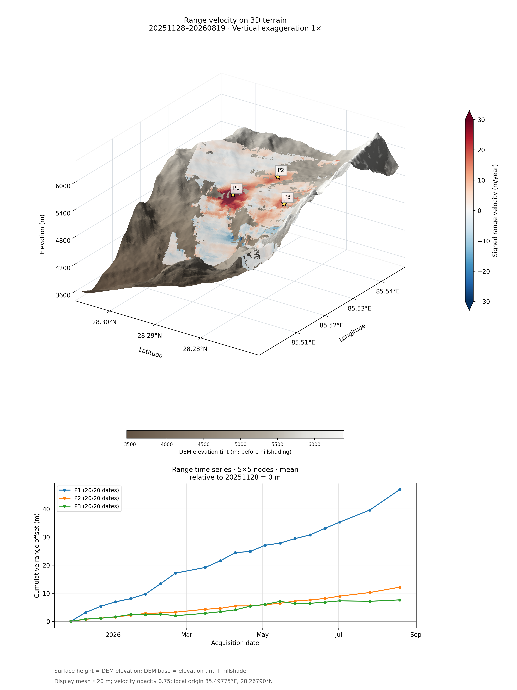
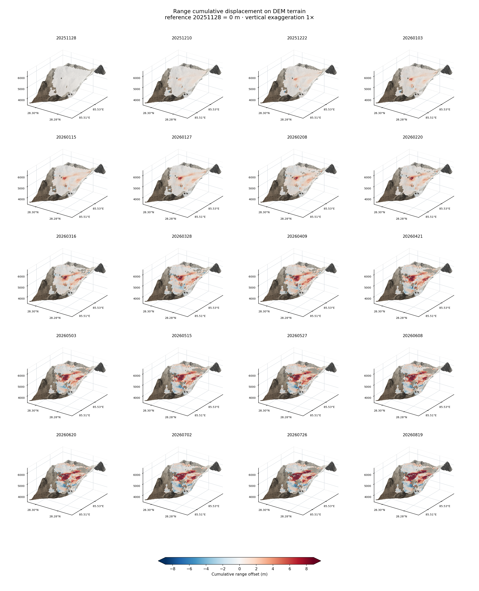
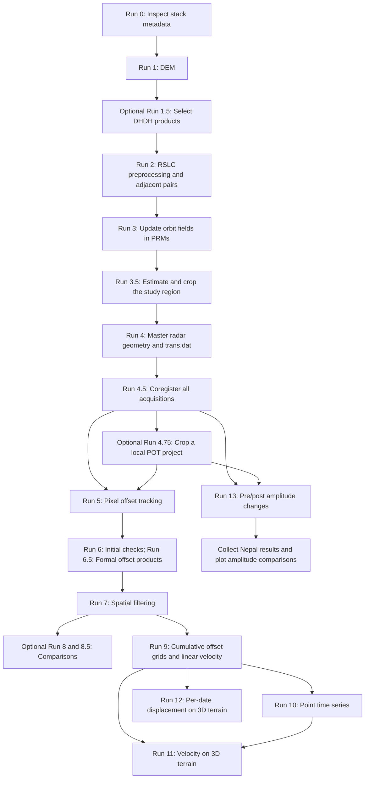

# NISAR POT Time Series

**Pixel offset tracking time series from NISAR RSLC data, illustrated with a glacier example.**

[English](README.md) | [简体中文](README.zh-CN.md)

This workflow converts NISAR RSLC products to GMTSAR files, registers acquisitions to one master radar grid, measures adjacent-date pixel offsets, and generates cumulative range and azimuth offset time series. It also provides point time series and 2D/3D visualizations.

Repository: [Xin-Wang-520/nisar-pot-timeseries](https://github.com/Xin-Wang-520/nisar-pot-timeseries).

## Start with sparse window tests, then use dense sampling

Before processing the full time series, choose a representative date pair and compare `--xsearch` / `--ysearch` settings of **16, 32, 64 and 128**, using the same value in both directions initially. Start with relatively few correlation locations:

| Test grid | Requested locations (`nx × ny`) |
|---|---:|
| `--nx 50 --ny 60` | 3,000 |
| `--nx 150 --ny 200` | 30,000 |

Compare coverage, SNR, outliers, striping and retention of glacier features in both range and azimuth products. Select a suitable search setting before increasing the sampling density; the largest setting is not necessarily the best.

For the final run, increase **`nx` and `ny` until the `xcorr_mt` log reports `x_inc=1` and `y_inc=1`**. This samples at one radar pixel in each direction within the valid correlation area and may require hundreds of thousands or millions of locations, depending on the ROI. **Do not set `nx=1` and `ny=1`: these parameters specify the numbers of sampling locations, not their spacing.** For the original 1300×1024-pixel local ROI with search settings of 64, `--nx 913 --ny 639` produced 583,407 locations with `x_inc=1, y_inc=1`; this is an example, not a universal grid size. Check the actual log for each ROI and search setting, and regenerate the run tag whenever the parameters change.

This is full-density sampling of the valid radar area. The correlation window still controls the effective spatial resolution, adjacent estimates overlap, and window margins prevent coverage of the entire input image. Allow substantially more time and storage for the dense run.

## Example results: Nepal

Results from the Nepal glacier study area, covering 28 November 2025 to 19 August 2026. Surface height represents DEM elevation; colours represent the radar range component.

### Range velocity and point time series (Run 11)

Range velocity draped on 3D terrain, with cumulative range displacement time series for P1, P2 and P3 below. Point values are means over 5×5 geographic grid nodes; displacement is relative to 28 November 2025.



### Cumulative range displacement by date (Run 12)

Twenty acquisition dates shown on 3D terrain, with the first date set to 0 m and a shared displacement colour scale in metres.



## Processing order



| Step | Script | Main result |
|---|---|---|
| 0 | `run0_nisar_check_stack.py` | Read-only sampling/frequency/bandwidth report |
| 1 | `run1_nisar_make_dem.py` | `topo/dem.grd` |
| 1.5, optional | `run1.5_nisar_select_dhdh.py` | Keep DHDH products and archive other configurations with sidecars |
| 2 | `run2_nisar_preprocess.sh` | `raw/`, `inputs.tsv`, `adjacent_pairs.tsv` |
| 3 | `run3_nisar_update_orbit_prm.sh` | Orbit geometry fields in raw PRMs |
| 3.5 | `run3.5_nisar_slc_crop.sh` | Mode 1: ROI preview; mode 2: cropped `SLC/` |
| 4 | `run4_nisar_make_topo.sh` | `dem_roi.grd`, `topo_ra.grd`, `trans.dat` |
| 4.5 | `run4.5_nisar_coregister.py` | Mode 1: `SLC_coreg_full/` and registration diagnostics |
| 4.75, optional | `run4.75_nisar_crop_coreg.py` | Local project with `SLC_coreg_cut/` |
| 5 | `run5_nisar_xcorr_mt.sh` | Mode 1: `freq_xcorr.dat`; mode 2: quicklooks |
| 6: initial checks; 6.5: formal processing | `run6_nisar_offset_products.sh` / `run6.5_nisar_offset_products_mclip.sh` | Range/azimuth grids in pixels and metres, maps and KMZ |
| 7 | `run7_nisar_filter_offsets.sh` | Filtered range/azimuth offset grids |
| 8, optional | `run8_nisar_compare_windows.py` | Comparison of search-window experiments |
| 8.5, optional | `run8.5_nisar_pair_panels.py` | All adjacent pairs in separate range/azimuth panels |
| 9 | `run9_nisar_pot_timeseries.py` | Mode 1: `disp_YYYYMMDD.grd` and `vel.grd`; mode 2: 2D maps |
| 10 | `run10_nisar_point_timeseries.py` | Point curves, TSV values and point-location maps |
| 11 | `run11_nisar_terrain3d.py` | Separate range/azimuth velocity draped on DEM terrain |
| 12 | `run12_nisar_terrain3d_dates.py` | Per-date 3D displacement maps and all-date panels |
| 13 | `run13_nisar_amplitude_change.py` | Registered-SLC amplitude/power changes, maps and KMZ |
| Collection | `collect_nepal_sar_results.py` | Nepal results bundle with source paths and SHA256 manifest |
| Comparison | `plot_nepal_amplitude_4x3.py` | Four datasets in a four-row, three-column regional figure |

Run 4.5 mode 2 is an optional common-window crop; Run 5 uses mode 1 products directly. Use **Run 6 first for initial testing and checking**, then **Run 6.5 for formal processing**. Run 6.5 includes the Run 6 product-generation steps and adds metre-based rejection; it reads Run 5 measurements directly, rather than consuming Run 6 products.

## Units and range sign convention

Range offsets are converted to metres using the positive PRM slant-range sample spacing, **without multiplying by −1**. **Positive range offsets mean motion away from the satellite; negative range offsets mean motion toward the satellite.** This convention also applies to cumulative range displacement and range velocity. These are radar range components, not vertical displacement or total glacier speed. Range and azimuth products are processed and plotted separately. Displacement is in metres and velocity in metres/year.

## Requirements and inputs

- Linux-style command-line environment with Bash, Python 3, C shell/tcsh and standard Unix utilities.
- GMT and a GMTSAR installation with NISAR support, including `make_slc_nsr`, `calc_dop_orb`, `cut_slc`, `dem2topo_ra.csh`, `SAT_baseline`, `fitoffset_ra.csh` and `resamp`.
- A working parallel `xcorr_mt` executable. The workflow scripts call this executable; its implementation is not supplied by these scripts.
- NumPy and Matplotlib for Python figures; additional utilities used by the installed GMTSAR scripts must be available in `PATH`.
- `h5py` for Run 0. Run 13 also uses GMTSAR `conv`, `make_gaussian_filter`, `gmtsar_sharedir.csh`, geographic projection tools and Ghostscript.
- NISAR primary RSLC `.h5` files in `data/`, with one consistent track/frame/polarization/frequency geometry. Run 2 selects one release per date and creates the adjacent-pair list. Its converter call currently uses the `AHH` channel argument; adapt it before processing another channel.

The example below assumes the scripts are directly inside the processing project directory, beside `data/`. Keep Run 11 and Run 12 together because Run 12 imports grid-reading and tick helpers from Run 11. Activate the GMTSAR environment before running the commands.

Most scripts preview when the mode is omitted and process with `1`. Modes are script-specific: in particular, **Run 3.5 mode 2 performs the actual SLC crop**, while Run 5/6/6.5/7/9 mode 2 redraws existing products. Use each script's `--help` before changing a workflow.

## Stack checks and optional DHDH selection

Run 0 reads metadata without generating SLCs. Set the starting date explicitly for the stack being checked:

```bash
python3 run0_nisar_check_stack.py --data "$PWD/data" --start-date 20200101

# Optional: preview product selection, then move other configurations
python3 run1.5_nisar_select_dhdh.py --data "$PWD/data"
python3 run1.5_nisar_select_dhdh.py 1 --data "$PWD/data"
```

Run 1.5 scans the top level of `data/`, keeps DHDH, and moves other configurations and sidecars into `data/not_DHDH/` by default. It preserves existing archive contents and records moves in a journal. Selection does not harmonize spectra or certify sampling compatibility: retain Run 0 and the original Run 2 checks. See [Run 1.5 notes](run1.5_README.md). In the Nepal example, T48D pre-event time series end on **20260816**, while T98A ends on **20260819**; the event date is 20260826.

## Glacier example

These dates, coordinates and parameters describe one example, not universal defaults. The selected master is `20260620`; the cumulative time reference is the **first acquisition**, which can be a different date. Adjust process counts to the available CPU and memory.

### 1. Prepare, crop and coregister

Coordinate argument orders differ:

| Script | Geographic bounds |
|---|---|
| Run 1 | `--bbox WEST SOUTH EAST NORTH` |
| Run 3.5 | `--bbox WEST NORTH EAST SOUTH` |
| Run 4.75 | `--upper-left WEST NORTH --lower-right EAST SOUTH` |

```bash
# Run 1: DEM (--margin is in degrees here)
./run1_nisar_make_dem.py 1 --bbox 85.493 28.266 85.554 28.343

# Run 2: RSLC conversion and adjacent-date pairs
./run2_nisar_preprocess.sh 1 --data "$PWD/data" --jobs 5

# Run 3: update orbit fields before cropping
./run3_nisar_update_orbit_prm.sh 1

# Run 3.5: first estimate, then crop (--margin is in radar pixels)
./run3.5_nisar_slc_crop.sh 1 --master 20260620 \
  --bbox 85.493 28.343 85.554 28.266 --margin 0
./run3.5_nisar_slc_crop.sh 2 --master 20260620

# Run 4: geographic/radar lookup geometry
./run4_nisar_make_topo.sh 1 --master 20260620

# Run 4.5: first test one secondary; inspect its registration diagnostics
./run4.5_nisar_coregister.py 1 --master 20260620 \
  --date 20260702 --jobs 1 --nproc 8
# Then process the remaining acquisitions
./run4.5_nisar_coregister.py 1 --master 20260620 --jobs 4 --nproc 8

# Run 4.75: optional local project from already registered SLCs
./run4.75_nisar_crop_coreg.py 1 \
  --upper-left 85.510720 28.302668 \
  --lower-right 85.549344 28.270517 \
  --margin 32 --name glacier_example
```

Registration should be checked on stable terrain. Run 4.5 supports `--stable-box XMIN XMAX YMIN YMAX` in master radar coordinates; a fit dominated by moving ice can affect the measured motion. The local project reuses the original master's `trans.dat`; Run 5 restores cropped point coordinates to that original radar grid.

### 2. Track offsets and generate filtered products

```bash
local_project="$PWD/local_pot_roi/glacier_example"
nx=150
ny=200
nproc=8
tag="xs64_ys64_nx${nx}_ny${ny}"
components="f1_snr10_max0_m5_both"
filter="balanced_m5_g6_clip0"

# Run 5 mode 1: all adjacent pairs; add --pair PRE POST to test one pair
./run5_nisar_xcorr_mt.sh 1 --source "$local_project" \
  --xsearch 64 --ysearch 64 --nx "$nx" --ny "$ny" \
  --nproc "$nproc" --progress-seconds 10
# Run 5 mode 2: radar and geographic quicklooks
./run5_nisar_xcorr_mt.sh 2 --source "$local_project" --run5-tag "$tag" \
  --color-limit-px 2 --color-limit-m 5

# Run 6: first check one pair without metre-based clipping
./run6_nisar_offset_products.sh 1 \
  --source "$local_project" --run5-tag "$tag" --pair 20260620 20260702 \
  --factor 1 --min-snr 10 --max-abs-px 0

# Run 6.5: formal processing of all pairs, with metre-based clipping
./run6.5_nisar_offset_products_mclip.sh 1 \
  --source "$local_project" --run5-tag "$tag" \
  --factor 1 --min-snr 10 --max-abs-px 0 \
  --max-abs-m 5 --metric-components both

# Run 7: balanced filtering (median 5 cells; Gaussian 6 cells)
./run7_nisar_filter_offsets.sh 1 \
  --source "$local_project" --run5-tag "$tag" \
  --components-tag "$components" --profile balanced

# Optional all-pair comparison: pairwise offsets, not cumulative displacement
./run8.5_nisar_pair_panels.py 1 --source "$local_project" \
  --run5-tag "$tag" --components-tag "$components" --filter-tag "$filter" \
  --color-limit-m 5 --columns 4
```

Run 6.5's `±5 m` limit rejects measurements before gridding and can remove real fast motion; choose it from the application and inspect retained counts. A plot colour limit only controls display. Run 6 test products use `f1_snr10_max0`; formal Run 6.5 products use `f1_snr10_max0_m5_both`, which is selected by the downstream commands above. Run 8 requires the separately completed window experiments before it can compare them.

The example uses 30,000 requested correlation locations (`150×200`). A denser experiment can change `nx` and `ny` **and regenerate `tag` before running Run 5 onward**. In the original local case, `913×639` produced `x_inc=1, y_inc=1`; that relationship depends on crop size and search support. Dense sampling does not provide independent pixel-scale displacement resolution.

### 3. Cumulative maps and point curves

```bash
./run9_nisar_pot_timeseries.py 1 \
  --source "$local_project" --run5-tag "$tag" \
  --components-tag "$components" --filter-tag "$filter" --end-date 20260819
./run9_nisar_pot_timeseries.py 2 \
  --source "$local_project" --run5-tag "$tag" \
  --components-tag "$components" --filter-tag "$filter" --end-date 20260819 \
  --columns 4

./run10_nisar_point_timeseries.py 1 \
  --source "$local_project" --run5-tag "$tag" \
  --components-tag "$components" --filter-tag "$filter" --end-date 20260819 \
  --point 85.528032 28.292279 --label P1 \
  --point 85.535817 28.287288 --label P2 \
  --point 85.528000 28.281000 --label P3 \
  --window-cells 5 --statistic mean --min-valid 13
```

Run 10 reads geographic grid nodes, not independent raw correlation points. Check the valid-node counts in `point_timeseries.tsv`. Lowering `--min-valid` permits estimates from fewer nodes; it does not recover missing observations. P3 is an approximate example location selected from a map.

### 4. Three-dimensional terrain views

```bash
series="$local_project/pot_timeseries/${tag}_${components}_${filter}_through_20260819"

# Run 11: separate range/azimuth linear-velocity terrain maps;
# also add separate range and azimuth terrain + point-curve figures from the Run 10 table
./run11_nisar_terrain3d.py 1 \
  --source "$local_project" --dem "$PWD/topo/dem_roi.grd" \
  --run5-tag "$tag" --components-tag "$components" --filter-tag "$filter" \
  --end-date 20260819 --axes lonlat --lonlat-step 0.01 \
  --azimuth -145 --elevation 25 --vertical-exaggeration 1 \
  --dem-style earth --dem-colorbar --vel-limit-m-yr 30 \
  --point-timeseries "$series/point_timeseries/points3_a7ae9e0776_w5_mean_min13"

# Run 12: each date's cumulative offsets and separate all-date galleries
./run12_nisar_terrain3d_dates.py 1 \
  --source "$local_project" --dem "$PWD/topo/dem_roi.grd" \
  --run5-tag "$tag" --components-tag "$components" --filter-tag "$filter" \
  --end-date 20260819 --component both --axes lonlat --lonlat-step 0.01 \
  --azimuth -145 --elevation 25 --vertical-exaggeration 1 \
  --dem-style earth --spacing-m 20 --columns 4
```

The point-table path must match the folder printed by Run 10; it changes with point coordinates and sampling settings. Run 11 can omit `--point-timeseries` when only velocity terrain maps are needed. With `--component both`, this option writes `range_terrain3d_timeseries.png/.pdf` and `azimuth_terrain3d_timeseries.png/.pdf`; each combines that component’s velocity terrain map with its cumulative displacement curves. Use `--component range` or `--component azimuth` to select one direction. DEM colouring is an elevation tint with hillshading, not optical imagery. The `20 m` mesh controls rendering density, not measurement resolution.

## Amplitude changes and the Nepal results bundle

Run 13 starts from the registered SLCs produced by Run 4.5/4.75 and runs independently of POT/time-series inversion. This T98A example generates geographic grids, PNG/PDF and Google Earth KMZ:

```bash
python3 run13_nisar_amplitude_change.py 1 \
  --source "$local_project" --pair 20260819 20260831 \
  --smooth-m 60 --spacing-m 15 \
  --output "$PWD/amplitude_results/20260819_20260831/cut_geocoded"
```

For retained T48D DHDH acquisitions, the event pair is **20260816–20260909**. Run 13 saves an initial-filter product and an additional `gaussian_60m` product. Amplitude is the square root of filtered power; dB change is `10 log10(P_post/P_pre)`. Values are relative, without sigma0/gamma0 calibration or terrain radiometric normalization. The 15 m geographic sampling and 60 m filter parameter have different meanings. See [Run 13 details](run13_README.md).

The collector is configured for the documented Nepal server layout: `NISAR/T98A`, `NISAR/T48D`, `lutan/ASC` and `lutan/DESC`, including the date pairs and tags used here. Adapt paths and selections for another project. It collects final products, available scripts and DEMs. Preview does not copy data; identical existing files are skipped and conflicting data files stop the copy. Source processing directories are retained.

```bash
base="/data2/xinw/landsides/nepal_landsides"
bundle="$base/Nepal_20260826_SAR_Results"
python3 collect_nepal_sar_results.py --base "$base"
python3 collect_nepal_sar_results.py 1 --base "$base"

python3 plot_nepal_amplitude_4x3.py 1 --bundle "$bundle" \
  --region 85.512 85.536 28.278 28.299 \
  --nisar-level initial --change-limit-db 10 --dpi 300
```

Figure rows: **LuTan descending, NISAR T98A ascending, LuTan ascending, NISAR T48D descending**. Columns show pre-event relative power, post-event relative power, and dB change. Pre/post images share one scale within each row; each change panel has its own colourbar with the same ±10 dB range. `--region` changes the displayed extent only; source GRDs remain unchanged. NISAR defaults to the existing `initial` product; `--nisar-level gaussian_60m` selects the stored extra-filtered version. Outputs are under `02_Amplitude/Comparison_4x3/`. See [comparison plotting notes](plot_nepal_amplitude_4x3_README.md).

## Main products and interpretation

| Location | Meaning / units |
|---|---|
| `pot_pairs_coreg/PRE_POST_TAG/` | Pairwise correlation results and products |
| `pot_timeseries/PRODUCT/range/disp_YYYYMMDD.grd` | Cumulative range offset, m |
| `pot_timeseries/PRODUCT/azimuth/disp_YYYYMMDD.grd` | Cumulative azimuth offset, m |
| `pot_timeseries/PRODUCT/{range,azimuth}/vel.grd` | Linear trend over the selected record, m/year |
| `pot_timeseries/PRODUCT/point_timeseries/` | Run 10 curves, values and location checks |
| `pot_timeseries/PRODUCT/terrain3d/` | Run 11 velocity terrain figures |
| `pot_timeseries/PRODUCT/terrain3d_dates/{range,azimuth}/` | Run 12 date maps and galleries |
| `amplitude_results/PRE_POST/` | Run 13 amplitude and power change products |
| `Nepal_20260826_SAR_Results/` | Collected products, scripts and source/checksum manifest |

Range and azimuth are processed separately. Run 9 accumulates adjacent-pair offsets with the first scene fixed to zero; a missing increment propagates to later cumulative values at that node. This adjacent chain has no redundant temporal-network constraints or atmospheric correction. Its linear velocity map describes the average trend, not acceleration. Radar offset components are not a recovered 3D glacier velocity vector; the 3D figures use DEM elevation for surface height.

For a code repository, keep scripts and documentation in Git, and store RSLC/SLC files and generated processing products in the working data directory. Large input data and generated products are not included in this repository.
