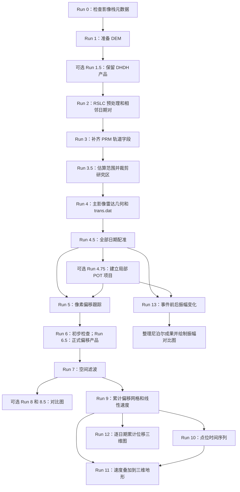

# NISAR POT 时间序列

**基于 NISAR RSLC 的像素偏移跟踪时间序列，以冰川研究为例。**

[English](README.md) | [简体中文](README.zh-CN.md)

这套脚本将 NISAR RSLC 转为 GMTSAR 文件，把所有日期配准到统一主影像雷达网格，计算相邻日期的像素偏移，再生成距离向（range）和方位向（azimuth）累计偏移时间序列，并提供点位曲线与二维、三维绘图。

仓库：[Xin-Wang-520/nisar-pot-timeseries](https://github.com/Xin-Wang-520/nisar-pot-timeseries)。

## 先少量测点测试窗口，再做逐像素加密

正式处理整个时间序列之前，先选择一对有代表性的日期，比较 **16、32、64、128** 四组 `--xsearch` / `--ysearch` 设置，初步测试时两个方向取相同值。先使用较少的相关测点：

| 测试网格 | 请求测点数（`nx × ny`） |
|---|---:|
| `--nx 50 --ny 60` | 3,000 |
| `--nx 150 --ny 200` | 30,000 |

比较 range 和 azimuth 的有效覆盖、SNR、异常点、条纹，以及冰川运动特征的保留情况，选出合适的搜索参数，再增加点数；窗口并非越大越好。

最终处理时，增大 **`nx`、`ny`，直到 `xcorr_mt` 日志显示 `x_inc=1`、`y_inc=1`**，即在有效相关区域内，距离向和方位向每隔一个雷达像素采样一次。根据研究区大小，可能需要几十万至几百万个测点。**不是把 `nx`、`ny` 设成 1：它们表示采样点数，`x_inc`、`y_inc` 才表示采样间隔。** 原始 1300×1024 像素局部研究区采用搜索参数 64 时，`--nx 913 --ny 639` 得到 583,407 个测点，日志为 `x_inc=1, y_inc=1`；这只是该区域的示例，不能直接套用到所有区域。每次改变裁剪范围或搜索参数，都应检查实际间隔；改变参数后同步更新 run tag。

这里的“全分辨率”指有效雷达区域内的逐像素密集采样。实际空间分辨率仍受相关窗口影响，相邻估计的窗口高度重叠，窗口边界也使测点不能覆盖整幅输入影像。密集处理需要预留更多运行时间和存储空间。

## 结果示例：尼泊尔

以下为尼泊尔冰川研究区的处理结果，时间范围为 2025 年 11 月 28 日至 2026 年 8 月 19 日。曲面高度表示 DEM 高程，颜色表示雷达距离向（range）分量。

### Range 速度与点位时间序列（Run 11）

上图为三维地形上的 range 速度，下图为 P1、P2、P3 的累计 range 位移时间序列。点位数值采用周围 5×5 个地理网格节点的均值，位移以 2025 年 11 月 28 日为零点。


### 各日期累计 range 位移（Run 12）

展示 20 个观测日期的三维累计位移，首期设为 0 m，所有子图使用统一的米制位移色标。


## 运行顺序



| 步骤 | 脚本 | 主要结果 |
|---|---|---|
| 0 | `run0_nisar_check_stack.py` | 只读检查采样、频率和带宽 |
| 1 | `run1_nisar_make_dem.py` | `topo/dem.grd` |
| 1.5，可选 | `run1.5_nisar_select_dhdh.py` | 保留 DHDH，其他配置及配套文件移入归档 |
| 2 | `run2_nisar_preprocess.sh` | `raw/`、`inputs.tsv`、`adjacent_pairs.tsv` |
| 3 | `run3_nisar_update_orbit_prm.sh` | raw PRM 中的轨道几何字段 |
| 3.5 | `run3.5_nisar_slc_crop.sh` | 模式 1 估算范围；模式 2 裁剪生成 `SLC/` |
| 4 | `run4_nisar_make_topo.sh` | `dem_roi.grd`、`topo_ra.grd`、`trans.dat` |
| 4.5 | `run4.5_nisar_coregister.py` | 模式 1 生成 `SLC_coreg_full/` 和配准诊断 |
| 4.75，可选 | `run4.75_nisar_crop_coreg.py` | 含 `SLC_coreg_cut/` 的局部项目 |
| 5 | `run5_nisar_xcorr_mt.sh` | 模式 1 计算 `freq_xcorr.dat`；模式 2 绘制快视图 |
| 6：初步检查；6.5：正式处理 | `run6_nisar_offset_products.sh` / `run6.5_nisar_offset_products_mclip.sh` | range/az 像素、米制网格，以及地图和 KMZ |
| 7 | `run7_nisar_filter_offsets.sh` | 滤波后的距离向、方位向偏移网格 |
| 8，可选 | `run8_nisar_compare_windows.py` | 不同搜索窗口实验对比 |
| 8.5，可选 | `run8.5_nisar_pair_panels.py` | 全部相邻日期对的 range、az 分方向总览 |
| 9 | `run9_nisar_pot_timeseries.py` | 模式 1 生成 `disp_YYYYMMDD.grd` 和 `vel.grd`；模式 2 绘制二维图 |
| 10 | `run10_nisar_point_timeseries.py` | 点位曲线、TSV 数值表和选点位置图 |
| 11 | `run11_nisar_terrain3d.py` | range、az 分别叠加到 DEM 的三维速度图 |
| 12 | `run12_nisar_terrain3d_dates.py` | 逐日期三维累计位移图及全部日期总览 |
| 13 | `run13_nisar_amplitude_change.py` | 已配准 SLC 的振幅、功率变化网格、地图和 KMZ |
| 成果整理 | `collect_nepal_sar_results.py` | 尼泊尔成果包，含来源路径和 SHA256 清单 |
| 振幅对比 | `plot_nepal_amplitude_4x3.py` | 四组数据的四行三列区域对比图 |

Run 4.5 模式 2 是额外的全时序共同窗口裁剪，Run 5 可直接使用模式 1 的配准结果。**先用 Run 6 测试和检查，再用 Run 6.5 正式处理**。Run 6.5 已包括 Run 6 的产品生成步骤，并增加按米阈值筛选；它直接读取 Run 5 的测点，不依赖 Run 6 的输出。

## 单位与 range 正负号约定

range 换算成米时**没有乘以 −1：正值表示远离卫星方向，负值表示朝向卫星方向**。累计 range 位移和速度沿用此约定；它们是雷达距离向分量，不是垂直位移或总流速。range 与 azimuth 分开处理和绘图，位移单位为米，速度单位为米/年。

## 环境与输入

- Linux 风格命令行环境，具有 Bash、Python 3、C shell/tcsh 和常用 Unix 工具。
- GMT，以及支持 NISAR 的 GMTSAR 环境，包括 `make_slc_nsr`、`calc_dop_orb`、`cut_slc`、`dem2topo_ra.csh`、`SAT_baseline`、`fitoffset_ra.csh`、`resamp`。
- 可用的并行 `xcorr_mt` 程序。这些流程脚本调用该程序，不包含其实现源码。
- Python 绘图需要 NumPy、Matplotlib；GMTSAR 脚本调用的其他程序也应在 `PATH` 中。
- Run 0 另需 `h5py`。Run 13 还调用 GMTSAR 的 `conv`、`make_gaussian_filter`、`gmtsar_sharedir.csh`、地理投影工具及 Ghostscript。
- 将 NISAR 主 RSLC `.h5` 文件放在 `data/` 中，保持轨道、frame、极化、频率几何一致。Run 2 按日期选择一个版本并生成相邻对。目前转换命令使用 `AHH` 通道参数，处理其他通道前需相应调整。

下方例子假设脚本直接放在处理项目目录中，与 `data/` 同级。Run 11 和 Run 12 应放在同一目录，Run 12 会导入 Run 11 的网格读取和刻度函数。执行命令前先激活 GMTSAR 环境。

多数脚本省略模式时预览，加 `1` 才正式处理；模式含义以各脚本为准。特别是 **Run 3.5 模式 2 才执行 SLC 裁剪**，而 Run 5/6/6.5/7/9 模式 2 是对已有产品重画。修改参数前可用各脚本的 `--help` 查看用法。

## 影像栈检查与可选 DHDH 筛选

Run 0 仅读取元数据，不生成 SLC。应按当前影像栈显式指定起始日期：

```bash
python3 run0_nisar_check_stack.py --data "$PWD/data" --start-date 20200101

# 可选：先预览配置选择，再移动其他配置
python3 run1.5_nisar_select_dhdh.py --data "$PWD/data"
python3 run1.5_nisar_select_dhdh.py 1 --data "$PWD/data"
```

Run 1.5 仅扫描 `data/` 顶层，保留 DHDH，将其他配置及其配套文件移到默认的 `data/not_DHDH/`，保留已有归档并记录移动日志。选择极化配置不等于统一频谱或验证采样兼容性，应继续保留 Run 0 和原 Run 2 的检查。详见 [Run 1.5 说明](run1.5_README.md)。尼泊尔示例中，T48D 的事件前时序截至 **20260816**，T98A 截至 **20260819**；事件日期为 20260826。

## 冰川示例

以下坐标、日期和参数属于一个示例，并非所有研究区通用。统一主影像选为 `20260620`；累计位移的零参考是**首个成像日期**，不一定与主影像日期相同。并行数应按服务器 CPU 和内存设置。

### 1. 准备数据、裁剪与配准

各脚本的经纬度范围参数顺序不同：

| 脚本 | 范围参数 |
|---|---|
| Run 1 | `--bbox 西 南 东 北` |
| Run 3.5 | `--bbox 西 北 东 南` |
| Run 4.75 | `--upper-left 西 北 --lower-right 东 南` |

```bash
# Run 1：准备 DEM，此处 --margin 的单位为度
./run1_nisar_make_dem.py 1 --bbox 85.493 28.266 85.554 28.343

# Run 2：转换 RSLC，生成相邻日期对
./run2_nisar_preprocess.sh 1 --data "$PWD/data" --jobs 5

# Run 3：裁剪前补齐轨道字段
./run3_nisar_update_orbit_prm.sh 1

# Run 3.5：先估算，再正式裁剪，此处 --margin 的单位为雷达像素
./run3.5_nisar_slc_crop.sh 1 --master 20260620 \
  --bbox 85.493 28.343 85.554 28.266 --margin 0
./run3.5_nisar_slc_crop.sh 2 --master 20260620

# Run 4：生成地理坐标与雷达坐标之间的几何关系
./run4_nisar_make_topo.sh 1 --master 20260620

# Run 4.5：先试一个次影像，检查配准诊断结果
./run4.5_nisar_coregister.py 1 --master 20260620 \
  --date 20260702 --jobs 1 --nproc 8
# 再处理剩余日期
./run4.5_nisar_coregister.py 1 --master 20260620 --jobs 4 --nproc 8

# Run 4.75：可选，从已配准 SLC 中建立局部项目
./run4.75_nisar_crop_coreg.py 1 \
  --upper-left 85.510720 28.302668 \
  --lower-right 85.549344 28.270517 \
  --margin 32 --name glacier_example
```

应使用稳定地面检查配准。Run 4.5 支持主影像雷达坐标下的 `--stable-box XMIN XMAX YMIN YMAX`；若拟合被运动冰川主导，会影响测得的运动。局部项目继续使用原主影像的 `trans.dat`，Run 5 会将裁剪坐标还原到该原始主影像网格。

### 2. 像素偏移跟踪与滤波产品

```bash
local_project="$PWD/local_pot_roi/glacier_example"
nx=150
ny=200
nproc=8
tag="xs64_ys64_nx${nx}_ny${ny}"
components="f1_snr10_max0_m5_both"
filter="balanced_m5_g6_clip0"

# Run 5 模式 1：处理全部相邻对；加 --pair PRE POST 可先试一对
./run5_nisar_xcorr_mt.sh 1 --source "$local_project" \
  --xsearch 64 --ysearch 64 --nx "$nx" --ny "$ny" \
  --nproc "$nproc" --progress-seconds 10
# Run 5 模式 2：雷达坐标、地理坐标快视图
./run5_nisar_xcorr_mt.sh 2 --source "$local_project" --run5-tag "$tag" \
  --color-limit-px 2 --color-limit-m 5

# Run 6：先检查一对，不按米阈值裁剪
./run6_nisar_offset_products.sh 1 \
  --source "$local_project" --run5-tag "$tag" --pair 20260620 20260702 \
  --factor 1 --min-snr 10 --max-abs-px 0

# Run 6.5：正式处理所有日期对，并按米阈值筛选
./run6.5_nisar_offset_products_mclip.sh 1 \
  --source "$local_project" --run5-tag "$tag" \
  --factor 1 --min-snr 10 --max-abs-px 0 \
  --max-abs-m 5 --metric-components both

# Run 7：balanced 滤波，中值 5 cells、高斯 6 cells
./run7_nisar_filter_offsets.sh 1 \
  --source "$local_project" --run5-tag "$tag" \
  --components-tag "$components" --profile balanced

# 可选：全部相邻对的对比图，显示各日期对偏移而非累计位移
./run8.5_nisar_pair_panels.py 1 --source "$local_project" \
  --run5-tag "$tag" --components-tag "$components" --filter-tag "$filter" \
  --color-limit-m 5 --columns 4
```

Run 6.5 的 `±5 m` 是网格化之前的测点筛选，可能删掉真实快速运动，应结合研究对象设置并检查保留数量；绘图色标只改变显示范围。Run 6 测试产品的 tag 是 `f1_snr10_max0`；正式 Run 6.5 产品的 tag 是 `f1_snr10_max0_m5_both`，上面的后续命令选择正式产品。Run 8 需要分别完成不同窗口的实验后才能对比。

示例请求 30,000 个相关位置，即 `150×200`。做高密度实验时，应先修改 `nx`、`ny`，**重新生成 `tag`，再从 Run 5 开始运行**。原局部案例的 `913×639` 对应 `x_inc=1, y_inc=1`，该关系取决于裁剪尺寸和搜索窗口所需边界。高密度采样不等于每个像素都有独立的位移测量。

### 3. 累计网格与点位时间序列

```bash
./run9_nisar_pot_timeseries.py 1 \
  --source "$local_project" --run5-tag "$tag" \
  --components-tag "$components" --filter-tag "$filter" --end-date 20260819
./run9_nisar_pot_timeseries.py 2 \
  --source "$local_project" --run5-tag "$tag" \
  --components-tag "$components" --filter-tag "$filter" --end-date 20260819 \
  --columns 4

./run10_nisar_point_timeseries.py 1 \
  --source "$local_project" --run5-tag "$tag" \
  --components-tag "$components" --filter-tag "$filter" --end-date 20260819 \
  --point 85.528032 28.292279 --label P1 \
  --point 85.535817 28.287288 --label P2 \
  --point 85.528000 28.281000 --label P3 \
  --window-cells 5 --statistic mean --min-valid 13
```

Run 10 取的是地理网格节点，并非相互独立的原始互相关测点。应检查 `point_timeseries.tsv` 中每期有效节点数。降低 `--min-valid` 允许少量节点参与统计，并不会恢复缺测观测。P3 是从地图估计的示例点位。

### 4. 三维地形展示

```bash
series="$local_project/pot_timeseries/${tag}_${components}_${filter}_through_20260819"

# Run 11：range、az 分别绘制线性速度三维图；
# 同时用 Run 10 数值表分别绘制 range、azimuth 三维速度 + 同方向点位曲线组合图
./run11_nisar_terrain3d.py 1 \
  --source "$local_project" --dem "$PWD/topo/dem_roi.grd" \
  --run5-tag "$tag" --components-tag "$components" --filter-tag "$filter" \
  --end-date 20260819 --axes lonlat --lonlat-step 0.01 \
  --azimuth -145 --elevation 25 --vertical-exaggeration 1 \
  --dem-style earth --dem-colorbar --vel-limit-m-yr 30 \
  --point-timeseries "$series/point_timeseries/points3_a7ae9e0776_w5_mean_min13"

# Run 12：每个日期的累计位移三维图，以及两个方向各自的日期总览
./run12_nisar_terrain3d_dates.py 1 \
  --source "$local_project" --dem "$PWD/topo/dem_roi.grd" \
  --run5-tag "$tag" --components-tag "$components" --filter-tag "$filter" \
  --end-date 20260819 --component both --axes lonlat --lonlat-step 0.01 \
  --azimuth -145 --elevation 25 --vertical-exaggeration 1 \
  --dem-style earth --spacing-m 20 --columns 4
```

点位表路径应与 Run 10 终端打印的文件夹一致，坐标或采样设置变化时路径也会变化。Run 11 仅画速度地形图时可省略 `--point-timeseries`。默认 `--component both` 会生成 `range_terrain3d_timeseries.png/.pdf` 和 `azimuth_terrain3d_timeseries.png/.pdf`，各自上方为该方向的三维速度图、下方为同方向的累计位移曲线；也可用 `--component range` 或 `--component azimuth` 只画一个方向。DEM 底色是高程渐变叠加阴影，并非光学影像；`20 m` 绘图网格只控制显示密度，不提高测量分辨率。

## 振幅变化与尼泊尔成果包

Run 13 从 Run 4.5/4.75 已配准的 SLC 开始，可独立于 POT 和时序计算运行。以下 T98A 例子生成地理网格、PNG/PDF 和 Google Earth KMZ：

```bash
python3 run13_nisar_amplitude_change.py 1 \
  --source "$local_project" --pair 20260819 20260831 \
  --smooth-m 60 --spacing-m 15 \
  --output "$PWD/amplitude_results/20260819_20260831/cut_geocoded"
```

T48D 当前保留的 DHDH 跨事件日期对为 **20260816–20260909**。Run 13 保留初始滤波版本和额外的 `gaussian_60m` 版本。振幅为滤波功率的平方根，dB 变化为 `10 log10(P_post/P_pre)`。结果属于相对值，未做 sigma0/gamma0 定标或地形辐射归一化；15 m 地理采样与 60 m 滤波参数含义不同。详见 [Run 13 说明](run13_README.md)。

成果整理脚本按本次尼泊尔服务器目录配置：`NISAR/T98A`、`NISAR/T48D`、`lutan/ASC` 和 `lutan/DESC`，日期对及参数 tag 也对应本例。用于其他项目时应调整路径和选择条件。它整理最终成果、现有脚本和 DEM；预览不复制数据，已有同名文件内容一致则跳过，数据内容冲突则停止，保留原处理目录。

```bash
base="/data2/xinw/landsides/nepal_landsides"
bundle="$base/Nepal_20260826_SAR_Results"
python3 collect_nepal_sar_results.py --base "$base"
python3 collect_nepal_sar_results.py 1 --base "$base"

python3 plot_nepal_amplitude_4x3.py 1 --bundle "$bundle" \
  --region 85.512 85.536 28.278 28.299 \
  --nisar-level initial --change-limit-db 10 --dpi 300
```

四行顺序为 **陆探降轨、NISAR T98A 升轨、陆探升轨、NISAR T48D 降轨**。三列为事件前相对功率、事件后相对功率、dB 变化。每行前后图共用功率色标，每张变化图下方各有一条色标，四行统一 ±10 dB。`--region` 只改变显示范围，原 GRD 保持不变。NISAR 默认读已有 `initial` 版本；`--nisar-level gaussian_60m` 选择已存的额外滤波版本。输出在 `02_Amplitude/Comparison_4x3/`，详见 [四行三列绘图说明](plot_nepal_amplitude_4x3_README.md)。

## 主要输出与含义

| 位置 | 含义 / 单位 |
|---|---|
| `pot_pairs_coreg/PRE_POST_TAG/` | 日期对的互相关结果和产品 |
| `pot_timeseries/PRODUCT/range/disp_YYYYMMDD.grd` | 距离向累计偏移，m |
| `pot_timeseries/PRODUCT/azimuth/disp_YYYYMMDD.grd` | 方位向累计偏移，m |
| `pot_timeseries/PRODUCT/{range,azimuth}/vel.grd` | 所选时段的线性趋势，m/年 |
| `pot_timeseries/PRODUCT/point_timeseries/` | Run 10 曲线、数值表和位置图 |
| `pot_timeseries/PRODUCT/terrain3d/` | Run 11 速度三维地形图 |
| `pot_timeseries/PRODUCT/terrain3d_dates/{range,azimuth}/` | Run 12 逐日期图和总览图 |
| `amplitude_results/PRE_POST/` | Run 13 振幅和功率变化成果 |
| `Nepal_20260826_SAR_Results/` | 整理后的成果、脚本及来源/校验清单 |

range 和 az 分别处理。Run 9 把首景固定为零后，累加相邻日期对的偏移；某节点有一期增量缺测，会传到后面的累计值。该相邻链条没有冗余时序网络约束或大气校正。线性速度图表示时段平均趋势，不表示加速度；雷达偏移分量也不是反演得到的三维冰川速度向量，三维图中的高度来自 DEM。

代码仓库放脚本和说明，RSLC/SLC 与生成的处理产品保存在工作数据目录中。本仓库不包含大型输入数据和生成的处理结果。
